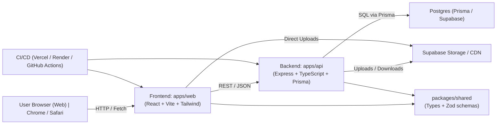

# Architecture Overview

This document provides a comprehensive overview of the portfolio application architecture, explaining the separation between frontend, backend, and shared code.

## 🏗️ High-Level Architecture

```
┌─────────────────────────────────────────────────────────────┐
│                        User's Browser                        │
│                     http://localhost:5173                    │
└───────────────────────────┬─────────────────────────────────┘
                            │
                            │ HTTP Requests
                            │ (with JWT cookies)
                            ▼
┌─────────────────────────────────────────────────────────────┐
│                    Frontend (apps/web)                       │
│                                                              │
│  ┌────────────┐  ┌────────────┐  ┌──────────────┐         │
│  │   React    │  │   React    │  │   TanStack   │         │
│  │   Router   │  │ Components │  │    Query     │         │
│  └────────────┘  └────────────┘  └──────────────┘         │
│                                                              │
│  ┌──────────────────────────────────────────────┐          │
│  │        API Client (lib/api.ts)               │          │
│  │     Communicates with backend API            │          │
│  └──────────────────────────────────────────────┘          │
└───────────────────────────┬─────────────────────────────────┘
                            │
                            │ REST API Calls
                            │ /api/profile
                            │ /api/projects
                            │ /api/posts
                            ▼
┌─────────────────────────────────────────────────────────────┐
│                   Backend (apps/api)                         │
│                  http://localhost:5000                       │
│                                                              │
│  ┌────────────────┐  ┌────────────┐  ┌────────────┐       │
│  │  Express.js    │  │    JWT     │  │  Prisma    │       │
│  │   REST API     │  │    Auth    │  │    ORM     │       │
│  └────────────────┘  └────────────┘  └────────────┘       │
│                                              │               │
│  ┌───────────────────────────────────────────┘              │
│  │                                                           │
│  ▼                                                           │
│  Routes:                                                     │
│  • /api/profile      (Public)                               │
│  • /api/projects     (Public)                               │
│  • /api/posts        (Public)                               │
│  • /api/auth/login   (Auth)                                 │
│  • /api/admin/*      (Protected - requires JWT)            │
│                                                              │
└───────────────────────────┬─────────────────────────────────┘
                            │
                            │ SQL Queries
                            │ (via Prisma)
                            ▼
┌─────────────────────────────────────────────────────────────┐
│                   PostgreSQL Database                        │
│                                                              │
│  Tables:                                                     │
│  • AdminUser    (admin accounts)                            │
│  • Profile      (personal info)                             │
│  • Service      (services offered)                          │
│  • Project      (portfolio projects)                        │
│  • Post         (blog posts)                                │
└─────────────────────────────────────────────────────────────┘

                            ┌─────────────────┐
                            │  Shared Package │
                            │ (packages/shared)│
                            │                  │
                            │ • TypeScript     │
                            │   Types          │
                            │ • Zod Schemas    │
                            │                  │
                            └─────────────────┘
                                     │
                        ┌────────────┴────────────┐
                        │                         │
                        ▼                         ▼
                   Frontend                  Backend
                  (Type Safety)        (Runtime Validation)
```

### Mermaid Diagram

You can render the same diagram in a Mermaid viewer or use the included file at `diagrams/architecture.mmd`.




## 📁 Monorepo Structure

```
portfolio/
│
├── apps/                          # Applications
│   │
│   ├── web/                       # 🎨 FRONTEND
│   │   ├── src/
│   │   │   ├── main.tsx          # Entry point
│   │   │   ├── App.tsx           # Root component
│   │   │   ├── app/
│   │   │   │   └── router.tsx    # Route definitions
│   │   │   │
│   │   │   ├── pages/            # 📄 Page Components
│   │   │   │   ├── HomePage.tsx
│   │   │   │   ├── AboutPage.tsx
│   │   │   │   ├── ProjectsPage.tsx
│   │   │   │   ├── ProjectDetailPage.tsx
│   │   │   │   ├── BlogPage.tsx
│   │   │   │   ├── PostDetailPage.tsx
│   │   │   │   └── ...
│   │   │   │
│   │   │   ├── components/       # 🧩 Reusable UI Components
│   │   │   │   ├── Navbar.tsx
│   │   │   │   ├── Footer.tsx
│   │   │   │   ├── Button.tsx
│   │   │   │   ├── Card.tsx
│   │   │   │   └── ...
│   │   │   │
│   │   │   ├── hooks/            # 🪝 Custom React Hooks
│   │   │   │   └── public.ts     # API hooks (useProfile, useProjects)
│   │   │   │
│   │   │   ├── lib/              # 📚 Libraries
│   │   │   │   ├── api.ts        # API client setup
│   │   │   │   ├── queryClient.ts # React Query config
│   │   │   │   └── env.ts        # Environment variables
│   │   │   │
│   │   │   └── utils/            # 🛠️ Utilities
│   │   │       └── cn.ts         # Tailwind class merger
│   │   │
│   │   ├── public/               # Static assets
│   │   ├── dist/                 # Build output
│   │   ├── index.html
│   │   ├── package.json
│   │   ├── vite.config.ts        # Vite configuration
│   │   ├── tailwind.config.js    # Tailwind configuration
│   │   └── README.md             # Frontend documentation
│   │
│   └── api/                       # ⚙️ BACKEND
│       ├── src/
│       │   ├── index.ts          # Entry point (Express app)
│       │   ├── prisma.ts         # Prisma client instance
│       │   │
│       │   ├── lib/              # 📚 Libraries
│       │   │   ├── auth.ts       # JWT utilities
│       │   │   └── env.ts        # Environment validation
│       │   │
│       │   ├── middleware/       # 🔒 Middleware
│       │   │   └── requireAdmin.ts # Auth middleware
│       │   │
│       │   └── routes/           # 🛣️ API Routes
│       │       ├── public.ts     # Public endpoints
│       │       ├── auth.ts       # Authentication
│       │       └── admin.ts      # Protected CRUD
│       │
│       ├── prisma/
│       │   ├── schema.prisma     # Database schema
│       │   ├── migrations/       # Database migrations
│       │   └── seed.ts           # Seed script
│       │
│       ├── dist/                 # Compiled JavaScript
│       ├── package.json
│       ├── tsconfig.json
│       └── README.md             # Backend documentation
│
├── packages/                      # 📦 SHARED CODE
│   └── shared/
│       ├── src/
│       │   ├── index.ts          # Exports
│       │   ├── types.ts          # TypeScript types
│       │   └── schemas.ts        # Zod validation schemas
│       │
│       ├── dist/                 # Compiled output
│       ├── package.json
│       └── README.md             # Shared package docs
│
├── package.json                   # Root package (workspaces)
├── README.md                      # Main documentation
└── ARCHITECTURE.md                # This file
```

## 🔄 Data Flow

### 1. Public Content Display (Read-Only)

```
User visits page
    ↓
React component mounts
    ↓
React Query hook executes (e.g., useProjects())
    ↓
HTTP GET request to backend (/api/projects)
    ↓
Express route handler (routes/public.ts)
    ↓
Prisma query to PostgreSQL
    ↓
Data returned to frontend
    ↓
React Query caches data
    ↓
Component renders with data
```

**Example:**
```typescript
// Frontend: hooks/public.ts
export function useProjects() {
  return useQuery<ProjectPublic[]>({
    queryKey: ["projects"],
    queryFn: async () => {
      const res = await apiClient.get("/api/projects");
      return await res.json();
    },
  });
}

// Backend: routes/public.ts
router.get("/projects", async (req, res) => {
  const projects = await prisma.project.findMany({
    where: { publishedAt: { not: null } },
    orderBy: { publishedAt: "desc" },
  });
  res.json(projects);
});
```

### 2. Admin Content Management (Protected)

```
Admin logs in
    ↓
Backend validates credentials
    ↓
JWT token issued (HTTP-only cookie)
    ↓
Admin makes changes (create/update/delete)
    ↓
Request includes JWT cookie
    ↓
requireAdmin middleware verifies JWT
    ↓
Zod schema validates request data
    ↓
Prisma updates database
    ↓
Success response sent
    ↓
React Query invalidates cache
    ↓
UI updates with fresh data
```

**Example:**
```typescript
// Frontend: Admin creates project
const mutation = useMutation({
  mutationFn: async (data: ProjectPublic) => {
    const res = await apiClient.post("/api/admin/projects", data);
    return await res.json();
  },
  onSuccess: () => {
    queryClient.invalidateQueries(["projects"]);
  },
});

// Backend: routes/admin.ts
router.post("/projects", requireAdmin, async (req, res) => {
  // Validate with Zod
  const data = projectPublicSchema.parse(req.body);
  
  // Save to database
  const project = await prisma.project.create({ data });
  
  res.json(project);
});
```

## 🔐 Authentication Flow

```
┌─────────────┐
│   Admin     │
│  attempts   │
│   login     │
└──────┬──────┘
       │
       │ POST /api/auth/login
       │ { email, password }
       ▼
┌─────────────────────────┐
│  Backend validates      │
│  credentials against    │
│  AdminUser table        │
└──────┬──────────────────┘
       │
       │ ✅ Valid
       ▼
┌─────────────────────────┐
│  Generate JWT token     │
│  Set HTTP-only cookie   │
└──────┬──────────────────┘
       │
       │ Cookie: auth_token=<JWT>
       ▼
┌─────────────────────────┐
│  Frontend stores        │
│  cookie automatically   │
└──────┬──────────────────┘
       │
       │ Subsequent requests
       │ include cookie
       ▼
┌─────────────────────────┐
│  requireAdmin           │
│  middleware verifies    │
│  JWT on protected       │
│  routes                 │
└─────────────────────────┘
```

## 📦 Shared Package Integration

The `@portfolio/shared` package ensures type safety and consistency:

### Frontend Usage
```typescript
import { ProjectPublic, PostPublic } from "@portfolio/shared";

// Type-safe hooks
export function useProjects(): UseQueryResult<ProjectPublic[]> {
  return useQuery(/* ... */);
}

// Type-safe props
interface ProjectCardProps {
  project: ProjectPublic;
}
```

### Backend Usage
```typescript
import { projectPublicSchema, postPublicSchema } from "@portfolio/shared";

// Runtime validation
router.post("/projects", async (req, res) => {
  const data = projectPublicSchema.parse(req.body);
  // data is now validated and typed!
});
```

### Benefits
- ✅ Single source of truth for types
- ✅ Frontend gets compile-time type checking
- ✅ Backend gets runtime validation
- ✅ Changes propagate to both apps
- ✅ No type drift between frontend/backend

## 🗄️ Database Schema Overview

```
AdminUser
├── id (PK)
├── email (unique)
├── passwordHash
├── createdAt
└── updatedAt

Profile (singleton)
├── id (PK)
├── heroHello
├── heroName
├── heroTitle
├── heroTagline
├── avatarUrl
├── bio
├── contactEmail
├── socialLinks (JSON)
├── aboutSkills (JSON)
├── aboutEducation (JSON)
├── aboutExperience (JSON)
├── createdAt
└── updatedAt

Service
├── id (PK)
├── title
├── description
├── icon
├── order
├── createdAt
└── updatedAt

Project
├── id (PK)
├── title
├── slug (unique)
├── summary
├── techStack (array)
├── coverImageUrl
├── repoUrl
├── liveUrl
├── body
├── publishedAt (nullable - for drafts)
├── createdAt
└── updatedAt

Post
├── id (PK)
├── title
├── slug (unique)
├── excerpt
├── body
├── coverImageUrl
├── publishedAt (nullable - for drafts)
├── createdAt
└── updatedAt
```

## 🛣️ API Route Structure

### Public Routes (No Authentication)
```
GET  /api/profile            → Profile data
GET  /api/services           → List services
GET  /api/projects           → Published projects
GET  /api/projects/:slug     → Single project
GET  /api/posts              → Published posts
GET  /api/posts/:slug        → Single post
```

### Authentication Routes
```
POST /api/auth/login         → Admin login
POST /api/auth/logout        → Admin logout
GET  /api/auth/me            → Current admin user
```

### Admin Routes (JWT Required)
```
PUT    /api/admin/profile              → Update profile

POST   /api/admin/services             → Create service
PUT    /api/admin/services/:id         → Update service
DELETE /api/admin/services/:id         → Delete service

POST   /api/admin/projects             → Create project
PUT    /api/admin/projects/:id         → Update project
DELETE /api/admin/projects/:id         → Delete project

POST   /api/admin/posts                → Create post
PUT    /api/admin/posts/:id            → Update post
DELETE /api/admin/posts/:id            → Delete post
```

## 🔧 Technology Stack Summary

### Frontend Stack
| Technology | Purpose |
|------------|---------|
| React 19 | UI library |
| TypeScript | Type safety |
| Vite | Build tool & dev server |
| TailwindCSS | Styling framework |
| React Router | Client-side routing |
| TanStack Query | Data fetching & caching |
| Fetch API | HTTP requests |

### Backend Stack
| Technology | Purpose |
|------------|---------|
| Node.js | Runtime environment |
| TypeScript | Type safety |
| Express.js | Web framework |
| Prisma | ORM & database toolkit |
| PostgreSQL | Database |
| JWT | Authentication tokens |
| bcryptjs | Password hashing |
| Zod | Runtime validation |

### Shared Stack
| Technology | Purpose |
|------------|---------|
| TypeScript | Type definitions |
| Zod | Validation schemas |
| tsup | Bundler |

## 🚀 Development Workflow

### Starting Development
```bash
# Terminal 1: Backend
npm run dev:api

# Terminal 2: Frontend
npm run dev:web

# Terminal 3 (optional): Database GUI
npm -w apps/api run prisma:studio
```

### Making Changes

**To shared types/schemas:**
1. Edit `packages/shared/src/types.ts` or `schemas.ts`
2. Rebuild: `npm -w packages/shared run build`
3. Both frontend and backend pick up changes

**To backend:**
1. Edit files in `apps/api/src/`
2. Server auto-restarts (tsx watch mode)

**To frontend:**
1. Edit files in `apps/web/src/`
2. Browser auto-updates (Vite HMR)

**To database schema:**
1. Edit `apps/api/prisma/schema.prisma`
2. Create migration: `npm -w apps/api run prisma:migrate`
3. Regenerate client: `npm -w apps/api run prisma:generate`

## 🏗️ Build & Deploy

### Development
```bash
npm run dev:api      # Backend on :5000
npm run dev:web      # Frontend on :5173
```

### Production
```bash
npm run build        # Builds all apps

# Backend
cd apps/api
npm start            # Runs compiled code

# Frontend
# Deploy apps/web/dist to static hosting
```

## 🎯 Key Architectural Decisions

### 1. Monorepo Structure
**Why?** Easier to maintain shared code, simplified dependency management, atomic commits across frontend/backend.

### 2. Shared Package
**Why?** Type safety between frontend/backend, single source of truth, no type drift.

### 3. JWT in HTTP-only Cookies
**Why?** Secure (XSS protection), automatic inclusion in requests, no manual token management.

### 4. Prisma ORM
**Why?** Type-safe database queries, migrations, great developer experience.

### 5. React Query
**Why?** Automatic caching, refetching, loading states, optimistic updates.

### 6. Vite
**Why?** Fast HMR, modern build tool, great DX.

### 7. Zod Validation
**Why?** Runtime type checking, clear error messages, schema-based validation.

## 📚 Further Reading

- [Frontend Documentation](apps/web/README.md)
- [Backend Documentation](apps/api/README.md)
- [Shared Package Documentation](packages/shared/README.md)
- [Main README](README.md)

---

**This architecture provides clear separation of concerns while maintaining type safety and shared code between frontend and backend.** 🎯

